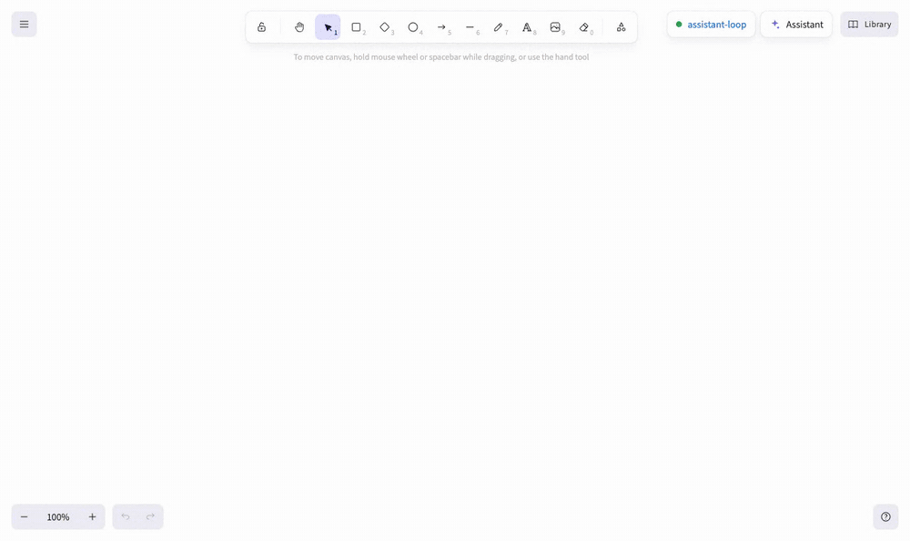
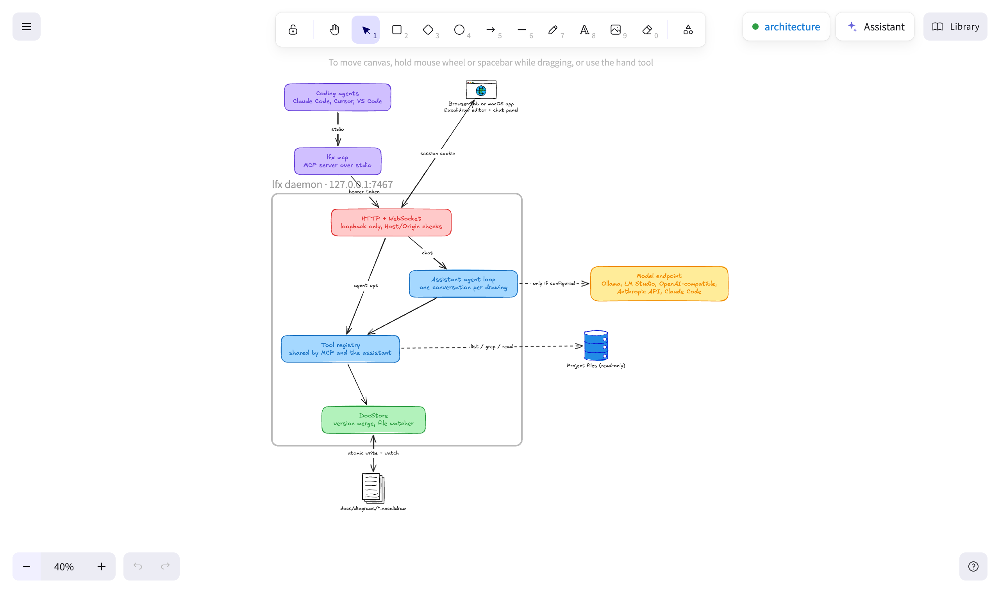

# local-first-excalidraw

The Excalidraw editor running entirely on your machine, with a drawing assistant beside the canvas and an MCP server so coding agents can draw and edit the same diagrams you do. Drawings are plain `.excalidraw` files in your repo. Nothing leaves the machine unless you point the assistant at a remote model.



*Above: asked to "read src/server/ai/agent.ts and draw how one chat message flows through the assistant", the assistant reads the file, looks up library shapes, draws the diagram, renders it to check the layout, redraws it, and explains what it drew. Real time is about 20 seconds with Claude Code (Sonnet).*

- **Your files are the source of truth.** Drawings are `.excalidraw` JSON (default `docs/diagrams/`), written with stable formatting for clean git diffs.
- **Live in both directions.** An agent's edit shows up in your open tab immediately. Your edits are saved within about 250 ms. A change on disk (an editor, `git checkout`) updates the tab too.
- **An assistant that reads your code.** Ask for a diagram of part of the project and it searches and reads the repository (read-only), then draws with real library shapes. Select items to ask about just those. It works with Ollama, LM Studio, llama.cpp, any OpenAI-compatible server, the Anthropic API, or your local Claude Code login.
- **Tools for coding agents.** Claude Code, Cursor, VS Code and other MCP clients get the same tools the assistant uses: graph to auto-laid-out diagram, Mermaid to Excalidraw, library shapes, bound arrows, plus a text description and a PNG render so they can check their work.
- **No network by default.** No CDN, telemetry, share links or collaboration server. [Tracing](docs/tracing.md) is opt-in and meant for a receiver on your machine. The page can only talk to the local daemon, which listens on `127.0.0.1`.

## Quick start

### macOS app

```bash
brew tap sean-michael/local-first-excalidraw https://github.com/Sean-Michael/local-first-excalidraw
```

```bash
brew trust sean-michael/local-first-excalidraw
```

```bash
brew install --cask local-first-excalidraw
```

Open **Local Excalidraw** from Applications. You get a sidebar of drawings, native open and save panels, and `.excalidraw` files open from Finder. The app reuses a daemon that's already running and otherwise starts its own. Quitting the app (or a crash) stops the daemon unless you turn on **Keep the daemon running after quitting** in Settings; a daemon started on demand by `lfx` or a coding agent stops itself after 30 idle minutes. If macOS blocks the first launch (releases before 0.1.1 aren't notarized), open **System Settings → Privacy & Security** and click **Open Anyway**.

The cask also puts `lfx` on your PATH, so the agent setup below works without cloning the repo.

To update, upgrade the cask. `brew update` alone only refreshes the tap's metadata; it doesn't install anything.

```bash
brew update && brew upgrade --cask local-first-excalidraw
```

Homebrew quits the app before replacing it. A daemon an agent or `lfx open` started is replaced by the next client of a newer version. A daemon you kept running after quitting the app, or started with `lfx serve`, isn't: clients refuse to use a daemon of another version and say so. Stop it and the next client starts the new one:

```bash
lfx stop
```

### From source

Requires Node 20+.

```bash
git clone https://github.com/Sean-Michael/local-first-excalidraw && cd local-first-excalidraw
```

```bash
npm ci && npm run build && npm link
```

```bash
lfx open docs/diagrams/architecture.excalidraw
```

The daemon starts in the background and your browser opens the drawing:



`lfx open` with no file shows the list of drawings. `lfx status` and `lfx stop` manage the daemon; `lfx status` also flags a daemon whose version differs from the CLI's. `lfx roots` lists the folders the daemon may use, and `lfx roots remove DIR` forgets one.

## Turn on the assistant

Click **Assistant** at the top right of a drawing (⇧⌘A in the macOS app), open its settings, and add a model. For a fully local setup, run Ollama with a tool-calling model such as `gpt-oss:20b`. If you have Claude Code installed and signed in, pick **Claude Code** and it uses your existing login.

Then type what you want drawn, or select part of the drawing and ask for a change. Type `@` to mention a file or another drawing. ⌘Z undoes the assistant's edits.

[Using the assistant](docs/assistant.md) covers endpoints, settings, shape libraries and what the model can see.

## Connect a coding agent

In Claude Code:

```bash
claude mcp add excalidraw -- lfx mcp
```

Then ask it to *"draw the request path through our API, from the load balancer to the database"*. Any drawing open in a tab updates as the agent works, and when the agent renders a drawing to check its layout, it uses a hidden local Chrome or Chromium rather than opening a tab ([headless rendering](docs/configuration.md#headless-rendering)).

For the Claude Code plugin (adds a diagramming skill and `/excalidraw:diagram`), other MCP clients, and the full tool list, see [MCP server](docs/mcp.md).

## How it fits together


One daemon on `127.0.0.1:7467` owns every drawing. The browser, the macOS app, MCP clients and the assistant all edit through it, and it merges their changes by element version and writes files atomically. MCP clients and the assistant call the same tool registry, so an agent in your terminal and the chat panel can do exactly the same things.

This diagram was drawn with the project's own MCP tools and is a normal drawing: open [docs/diagrams/architecture.excalidraw](docs/diagrams/architecture.excalidraw) to edit it. [About the architecture](docs/architecture.md) explains the parts and how concurrent editing works.

## Documentation

- [Using the assistant](docs/assistant.md): endpoints, settings as JSON, shapes and libraries, context, undo, where requests go
- [MCP server](docs/mcp.md): connecting Claude Code and other clients, and every tool
- [About the architecture](docs/architecture.md): components, the assistant's loop, concurrent editing
- [Security model](docs/security.md): threats considered, defences, and the egress-isolated Docker setup
- [Configuration](docs/configuration.md): environment variables and `ai.json`
- [Tracing](docs/tracing.md): OpenTelemetry traces of the assistant's model calls, tools and edits
- [Development](docs/development.md): building, testing, the macOS app, and releases

The editor is the official [`@excalidraw/excalidraw`](https://github.com/excalidraw/excalidraw) package (MIT), the same editor as excalidraw.com, without the hosted app's sharing and collaboration services. MIT licensed.
