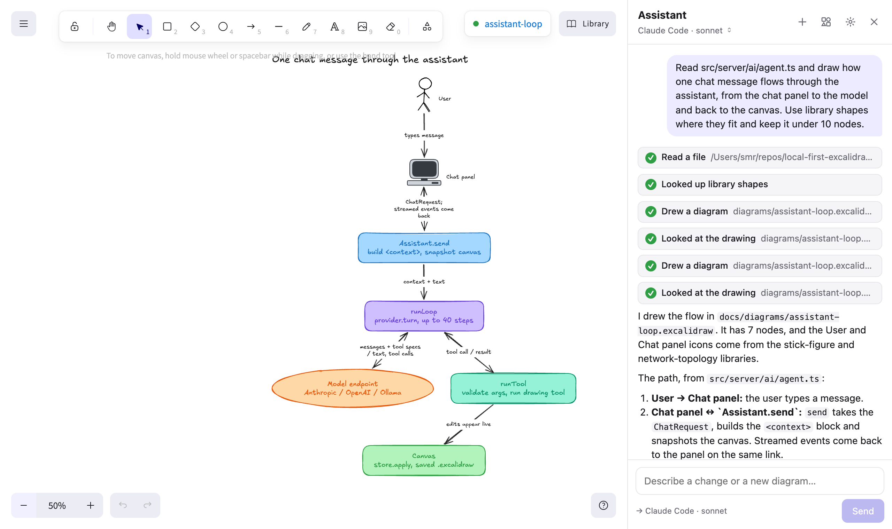
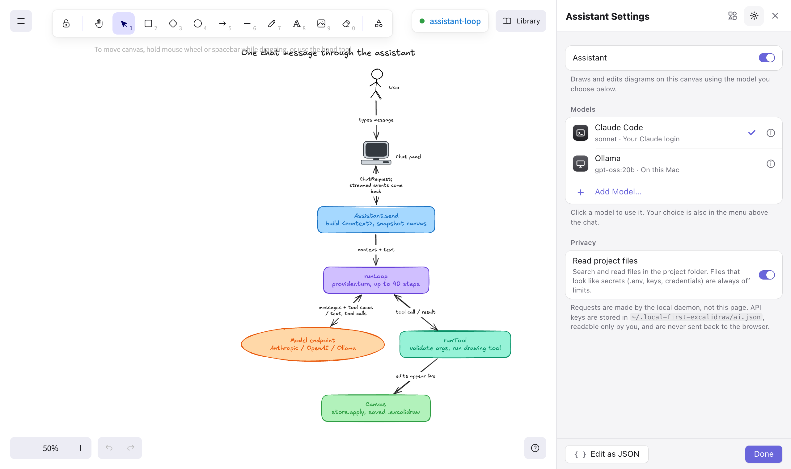
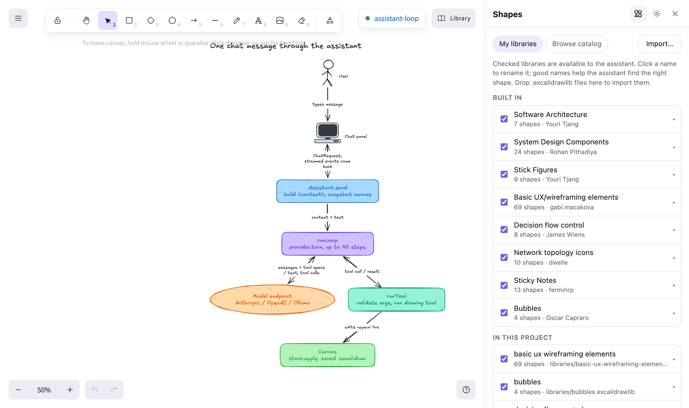

# Using the assistant

The assistant is a chat panel beside the canvas that draws and edits with the model you choose. It's off until you add a model, and nothing is sent anywhere before then.

## Open the panel

Click **Assistant** at the top right of a drawing. In the macOS app, use the toolbar button or **Toggle Assistant** (⇧⌘A).

Ask for a new diagram, or select items (drag a rectangle or click them) and ask for changes to just those. The selection chip above the input shows what will be sent; click it to leave the selection out. Type `@` to mention a project file or another drawing.

Each reply lists the tools it called (read a file, drew a diagram, looked at the drawing) and shows which endpoint answered.

## Add a model

Open settings with the gear icon and click **Add Model**.

| Endpoint | Notes |
|---|---|
| **Ollama** | Uses Ollama's native API so the context window can be set. The default is 32K; Ollama's own default of 4K is too small for the assistant's tools. Use a model with tool calling, such as `gpt-oss` or `qwen3-coder`. |
| **OpenAI-compatible** | LM Studio, llama.cpp (`llama-server --jinja`), vLLM, OpenAI, OpenRouter, and anything else that speaks Chat Completions. |
| **Anthropic API** | Default model `claude-opus-5-5`. Reads `ANTHROPIC_API_KEY` if you don't store a key. |
| **Claude Code** | Runs your local `claude` CLI with your existing login. It does its own code search with read-only file tools (Read, Grep, Glob) and edits drawings through this project's MCP server. It has no shell and no web access. |

A model without tool calling still works: it answers in Mermaid, which is converted into editable elements.

Click a model in the list to make it active. The same choice is in the menu under the panel title.

## Edit settings as JSON

Click **Edit as JSON** at the bottom of the settings. Comments and trailing commas are allowed, errors show their line, and unknown keys are flagged.

You can also edit `~/.local-first-excalidraw/ai.json` directly. The daemon picks up changes without a restart and keeps the last good settings if an edit doesn't parse. Saving from the app rewrites the file, which drops comments you added by hand.

API keys never appear in the in-app editor. Add `"apiKey": "…"` to an endpoint to set one, or `"apiKey": null` to remove it. The fields are listed in [Configuration](configuration.md#aijson).

## Shapes and libraries

The assistant draws with library shapes (people, databases, cloud icons, UI parts) instead of imitating them with boxes. Open the **Shapes** view (the grid icon) to manage them.

- **Built in.** Eight generic libraries ship with the app and work offline: Software Architecture, System Design Components, Stick Figures, Basic UX/Wireframing, Decision Flow Control, Network Topology Icons, Sticky Notes and Bubbles. They're MIT-licensed, from [the Excalidraw library catalog](https://github.com/excalidraw/excalidraw-libraries); [libraries/manifest.json](../libraries/manifest.json) lists the authors.
- **Browse catalog.** Every public library, most downloaded first, installed in one click. Vendor icon sets (AWS, Google Cloud, Azure, logos) live here rather than in the app. This is the only feature that downloads anything, and only when you click Install.
- **Import.** Drop `.excalidrawlib` files onto the Shapes view.
- **In this project.** `.excalidrawlib` files committed to the repo are picked up automatically, so a team can share its own icon set.

Click a shape's name to rename it. Many published libraries have unnamed items, and names are what the assistant searches, so good names matter. Names come from the catalog or from text inside the shape where possible. Untick a library to hide it from the assistant. **Add to canvas library** copies a set into Excalidraw's own Library sidebar so you can drag shapes in by hand.

## What the model sees

Each message carries:

- a compact text description of the drawing,
- the selected elements, plus a snapshot image of them for models marked as accepting images,
- the contents of anything you `@`-mention.

With **Read project files** on (the default), the model can also list, search and read files in the drawing's git repository on its own. File access is read-only, never leaves the repository, skips dependencies and `.gitignore`d paths, and refuses anything that looks like a secret (`.env`, keys, credentials).

## Chats and history

**+** starts a new chat; the previous one stays under the clock icon, newest first, so you can reopen it and carry on where you left off, or delete it. Each chat remembers its model: switching the model picker changes the open chat and becomes the default for new ones, so chats on other drawings keep the model they started with. If a chat switches between Claude Code and another endpoint, the earlier turns are passed along as text.

Chats on different drawings reply at the same time. On one drawing, only one chat replies at a time, so each reply's changes can still be reverted on their own.

## Undo a reply

The assistant's edits go on the canvas undo stack, so ⌘Z takes them back. Each reply also has **Revert changes**, which restores everything that reply changed except elements you've edited since.

## Where requests go

The local daemon makes every model request; the page only talks to the daemon. The panel always shows the destination, for example `→ localhost:11434 · gpt-oss:20b` or `→ Claude Code · sonnet`.

Keys are stored in `~/.local-first-excalidraw/ai.json` (mode 0600) and are never sent back to the browser. Changing an endpoint's URL drops its stored key, so a key can't be redirected to another host. Chats are kept per drawing in `~/.local-first-excalidraw/chats/`, one file per chat.
