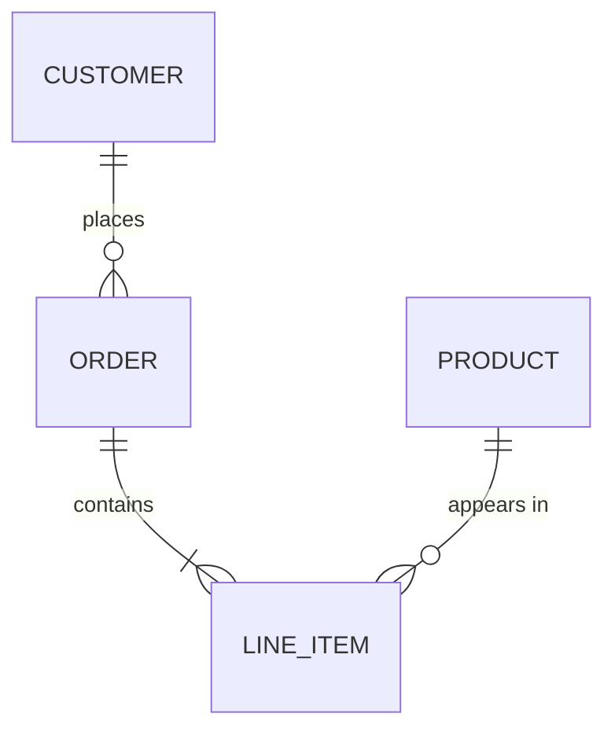

# Data models: entity-relationship diagrams
<!-- keywords: er diagram, erd, entity relationship, entity-relationship, data model, database schema, schema, tables, columns, primary key, foreign key, crow's foot, cardinality, relational -->

An ER diagram shows the things a system stores, their key attributes and how they relate. Peter Chen introduced the notation in 1976. Crow's-foot notation (Gordon Everest) is the one most engineers read today.

**Use it when:**

- you're explaining a database schema or a domain's data
- you're reviewing a migration or a new table
- you're planning how services split up data ownership
- you're onboarding someone to the data layer

**Don't use it** for object behaviour (use a class diagram) or for data in motion (use a DFD).

There are three levels, and you should pick one:

- **Conceptual:** entities and relationships only, for domain experts.
- **Logical:** entities, attributes and keys, with no database specifics.
- **Physical:** tables, columns, types, indexes and foreign keys, matching the migrations.

## Notation (crow's foot)

- An **entity** is a box with its name (singular noun, or the table name) and its attributes. Mark the keys: `PK`, `FK`, `UK`.
- A **relationship** is a line between entities with a verb phrase label ("places", "contains").
- **Cardinality** sits at each end of the line. The inner symbol is the maximum, and the outer one is the minimum:
  - `||` exactly one
  - `o|` zero or one
  - `}|` one or more
  - `}o` zero or more
- A **junction table** resolves a many-to-many relationship. Draw it explicitly at the physical level.
- An **identifying relationship** (the child's key includes the parent's) is a solid line. A non-identifying one is dashed. Mermaid uses `--` and `..` for these.

## Excalidraw recipe

Use `create_diagram`, one node per entity: the entity name as `label` and the keys and important columns as `attributes` (the rule line is added for you). Give each edge a crow's-foot `relation`, read from the `from` entity to the `to` entity: `one-to-one`, `one-to-many`, `one-to-one-or-many` or `many-to-many`. Point edges along the chain of references, so every edge joins neighbouring layers. Excalidraw has no "zero" marker, so spell the cardinality out at each end as well, with `startLabel` (the `from` end) and `endLabel` (the `to` end), and keep `label` for the verb phrase.

```json create_diagram
{
  "path": "docs/diagrams/orders-er",
  "direction": "LR",
  "title": "ER diagram: orders (logical)",
  "nodes": [
    { "id": "customer", "label": "CUSTOMER", "attributes": ["id PK", "email UK", "name"], "color": "green" },
    { "id": "order", "label": "ORDER", "attributes": ["id PK", "customer_id FK", "status", "placed_at"], "color": "green" },
    { "id": "line_item", "label": "LINE_ITEM", "attributes": ["order_id FK", "sku FK", "quantity"], "color": "green" },
    { "id": "product", "label": "PRODUCT", "attributes": ["sku PK", "title", "price_cents"], "color": "green" }
  ],
  "edges": [
    { "from": "customer", "to": "order", "relation": "one-to-many", "label": "places", "startLabel": "1", "endLabel": "0..*" },
    { "from": "order", "to": "line_item", "relation": "one-to-one-or-many", "label": "contains", "startLabel": "1", "endLabel": "1..*" },
    { "from": "product", "to": "line_item", "relation": "one-to-many", "label": "appears in", "startLabel": "1", "endLabel": "0..*" }
  ]
}
```

To change an end afterwards, set `startArrowhead` / `endArrowhead` (`crowfoot_one`, `crowfoot_many`, `crowfoot_one_or_many`) with `update_elements`. Arrow ids are `from->to`, with `#n` added for the n-th edge after the first.

Mermaid `erDiagram` is the standard text form, and the user may already have it. In this build, `mermaid_to_drawing` brings it in as one uneditable image (the result says "Converted Mermaid into 1 elements"). Translate it into the recipe above instead:



Other options:

- **Readers who don't know crow's feet:** add a short legend for the symbols (`visual-principles.md`).
- **A conceptual model:** use the same recipe without the attribute lines.
- To show **data ownership across services**, add one group per service, so tables owned by a service sit in its frame. Draw a cross-service reference as a dashed edge labelled `"references by id (no FK)"`.

Take entity and column names from the migrations or ORM models. Don't invent them. Link each entity to its model file (`living-diagrams.md`).

## Common mistakes

- **Every column shown.** Show the keys and the attributes that matter to the question, then write "+ 12 more" in a note if needed.
- **Cardinality guessed rather than read from constraints.** `NOT NULL` on a foreign key means the minimum is one.
- **Many-to-many drawn directly** in a physical model. Show the junction table.
- **Conceptual and physical mixed:** business names on some boxes, `tbl_` names on others.
- **Relationships with no verb label.**
- **A model that's out of date with the migrations.** Regenerate the affected entities when the schema changes.
