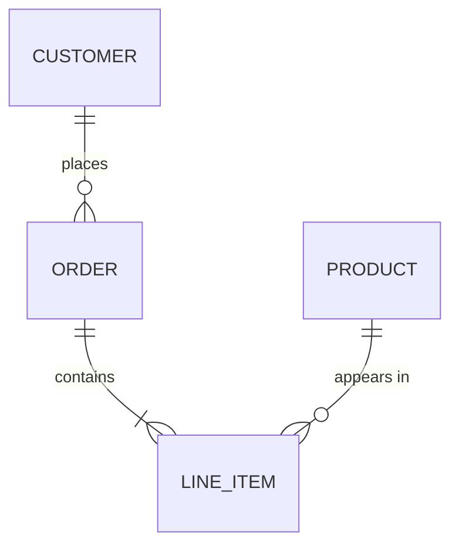

# Data models: entity-relationship diagrams

An ER diagram shows the things a system stores, their key attributes and how they relate. Peter Chen introduced the notation in 1976. Crow's-foot notation (Gordon Everest) is the one most engineers read today.

**Use it when:**

- you're explaining a database schema or a domain's data
- you're reviewing a migration or a new table
- you're planning how services split up data ownership
- you're onboarding someone to the data layer

**Don't use it** for object behaviour (use a class diagram) or for data in motion (use a DFD).

There are three levels, and you should pick one:

- **Conceptual:** entities and relationships only, for domain experts.
- **Logical:** entities, attributes and keys, with no database specifics.
- **Physical:** tables, columns, types, indexes and foreign keys, matching the migrations.

## Notation (crow's foot)

- An **entity** is a box with its name (singular noun, or the table name) and its attributes. Mark the keys: `PK`, `FK`, `UK`.
- A **relationship** is a line between entities with a verb phrase label ("places", "contains").
- **Cardinality** sits at each end of the line. The inner symbol is the maximum, and the outer one is the minimum:
  - `||` exactly one
  - `o|` zero or one
  - `}|` one or more
  - `}o` zero or more
- A **junction table** resolves a many-to-many relationship. Draw it explicitly at the physical level.
- An **identifying relationship** (the child's key includes the parent's) is a solid line. A non-identifying one is dashed. Mermaid uses `--` and `..` for these.

## Excalidraw recipe

Use `create_diagram`, one node per entity. Put the keys and important attributes in the label under a rule line. Point edges along the chain of references, so every edge joins neighbouring layers. Keep the rule shorter than the longest text line. Boxes are sized from the measured text, and an over-long rule wraps onto a second line that overflows the box.

```json create_diagram
{
  "path": "docs/diagrams/orders-er",
  "direction": "LR",
  "title": "ER diagram: orders (logical)",
  "nodes": [
    { "id": "customer", "label": "CUSTOMER\n─────\nid PK\nemail UK\nname", "color": "green" },
    { "id": "order", "label": "ORDER\n─────\nid PK\ncustomer_id FK\nstatus\nplaced_at", "color": "green" },
    { "id": "line_item", "label": "LINE_ITEM\n─────\norder_id FK\nsku FK\nquantity", "color": "green" },
    { "id": "product", "label": "PRODUCT\n─────\nsku PK\ntitle\nprice_cents", "color": "green" }
  ],
  "edges": [
    { "from": "customer", "to": "order", "label": "places (1 to 0..*)" },
    { "from": "order", "to": "line_item", "label": "contains (1 to 1..*)" },
    { "from": "line_item", "to": "product", "label": "refers to (0..* to 1)" }
  ]
}
```

Then swap the arrowheads for crow's feet. Excalidraw has `crowfoot_one`, `crowfoot_many` and `crowfoot_one_or_many`. There is no "zero" marker, which is why the labels above also spell the cardinality out. Arrow ids are `from->to`, with `#n` added for the n-th edge after the first:

```json update_elements
{
  "path": "docs/diagrams/orders-er",
  "updates": [
    { "id": "customer->order", "startArrowhead": "crowfoot_one", "endArrowhead": "crowfoot_many" },
    { "id": "order->line_item#1", "startArrowhead": "crowfoot_one", "endArrowhead": "crowfoot_one_or_many" },
    { "id": "line_item->product#2", "startArrowhead": "crowfoot_many", "endArrowhead": "crowfoot_one" }
  ]
}
```

Mermaid `erDiagram` is the standard text form, and the user may already have it. In this build, `mermaid_to_drawing` brings it in as one uneditable image (the result says "Converted Mermaid into 1 elements"). Translate it into the recipe above instead:



Other options:

- **Readers who don't know crow's feet:** add a short legend for the symbols (`visual-principles.md`).
- **A conceptual model:** use the same recipe without the attribute lines.
- To show **data ownership across services**, add one group per service, so tables owned by a service sit in its frame. Draw a cross-service reference as a dashed edge labelled `"references by id (no FK)"`.

Take entity and column names from the migrations or ORM models. Don't invent them. Link each entity to its model file (`living-diagrams.md`).

## Common mistakes

- **Every column shown.** Show the keys and the attributes that matter to the question, then write "+ 12 more" in a note if needed.
- **Cardinality guessed rather than read from constraints.** `NOT NULL` on a foreign key means the minimum is one.
- **Many-to-many drawn directly** in a physical model. Show the junction table.
- **Conceptual and physical mixed:** business names on some boxes, `tbl_` names on others.
- **Relationships with no verb label.**
- **A model that's out of date with the migrations.** Regenerate the affected entities when the schema changes.
