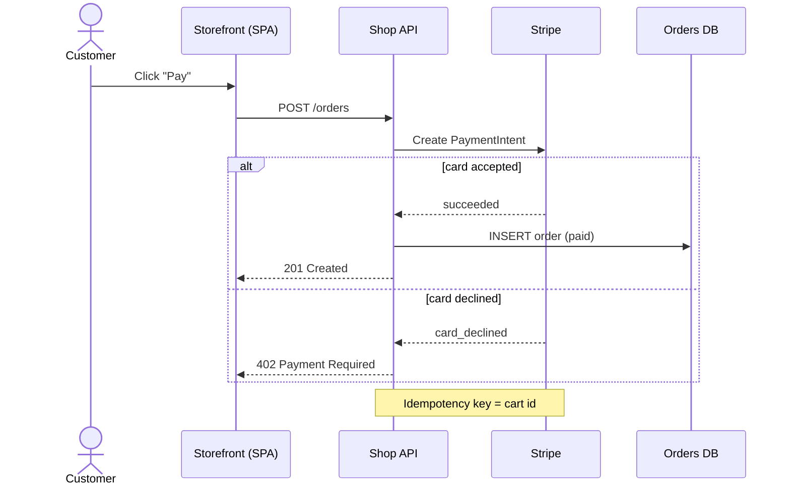

# UML behaviour diagrams: use case, activity, state machine, sequence, communication, interaction overview, timing
<!-- keywords: behavioural diagram, behavioral diagram, dynamic diagram, interaction diagram, use case diagram, use cases, actors, system boundary, include, extend, requirements, activity diagram, flowchart, workflow, process, swimlanes, fork, join, decision, guard, state machine, state diagram, statechart, lifecycle, status, transitions, sequence diagram, lifelines, messages, request flow, communication diagram, collaboration diagram, numbered messages, interaction overview, timing diagram -->

Behaviour diagrams show what happens over time: what users want from the system (use case), how a process flows (activity), how one thing's state changes (state machine), and how parts exchange messages (the four interaction diagrams: sequence, communication, interaction overview and timing). In the 4+1 view model (Kruchten, 1995) they belong to the process view and the scenarios. In arc42, they belong to the runtime view (section 6). Each one should cover one scenario, one process or one object's lifecycle.

## Use case diagram

**Use it when** you're capturing what a system does for whom: the actors (people and external systems) and the goals they use the system for, and where the system's boundary lies. It suits requirements, scoping and talking to non-technical stakeholders. It says nothing about how the use cases work: pair it with an activity or sequence diagram for that.

### Notation

- **Actors** are stick figures outside the system, named by role (`Customer`, `Bank`), not by person. Primary actors (who start a use case) go on the left, and secondary actors (who the system calls on) go on the right.
- **Use cases** are ellipses named with a verb phrase (`Withdraw Cash`), inside the **system boundary**: a rectangle labelled with the system's name.
- **Association:** a plain line between an actor and a use case it takes part in.
- **`«include»`:** a dashed arrow from a base use case to one it always uses (`Withdraw Cash` → `Authenticate`).
- **`«extend»`:** a dashed arrow from an optional use case to the base use case it sometimes extends (`Print Receipt` → `Withdraw Cash`), optionally with a condition.
- **Generalisation:** a hollow-triangle arrow from a specialised actor or use case to the general one.

### Excalidraw recipe

Use `create_diagram` with `direction: "LR"`. Put the use cases in a group whose label is the system's name: its frame is the system boundary. Leave the actors outside the group as `stick-figures/stick-man` shapes (check `list_shapes`) or ellipses. Use `relation: "association"` for actor lines, and `"include"` or `"extend"` for the dashed stereotyped arrows (the label is added for you).

```json create_diagram
{
  "path": "docs/diagrams/atm-use-cases",
  "direction": "LR",
  "title": "Use case diagram: ATM",
  "nodes": [
    { "id": "customer", "label": "Customer", "shape": "stick-figures/stick-man" },
    { "id": "withdraw", "label": "Withdraw Cash", "shape": "ellipse", "group": "atm", "color": "blue" },
    { "id": "balance", "label": "Check Balance", "shape": "ellipse", "group": "atm", "color": "blue" },
    { "id": "auth", "label": "Authenticate", "shape": "ellipse", "group": "atm", "color": "blue" },
    { "id": "receipt", "label": "Print Receipt", "shape": "ellipse", "group": "atm", "color": "blue" },
    { "id": "bank", "label": "Bank", "shape": "stick-figures/stick-man" }
  ],
  "groups": [{ "id": "atm", "label": "ATM" }],
  "edges": [
    { "from": "customer", "to": "withdraw", "relation": "association" },
    { "from": "customer", "to": "balance", "relation": "association" },
    { "from": "withdraw", "to": "auth", "relation": "include" },
    { "from": "balance", "to": "auth", "relation": "include" },
    { "from": "receipt", "to": "withdraw", "relation": "extend" },
    { "from": "auth", "to": "bank", "relation": "association" }
  ]
}
```

Render it and check that the extend arrow and the include arrows don't cross the use case labels. Move a use case with `update_elements` if they do.

### Common mistakes

- **Use cases that are steps** (`Enter PIN`, `Click OK`) instead of goals. Steps belong in an activity diagram.
- **Arrows between actors and use cases.** Associations are plain lines.
- **`«include»` and `«extend»` pointing the wrong way,** or used to draw a flowchart.
- **No system boundary,** or actors drawn inside it.
- **Too many use cases.** About 5–12 per diagram. Split by actor or feature area.

## Sequence diagram

**Use it when** the order of interactions between a few participants matters: a request path, an auth handshake, a retry or failure scenario, or an API integration. It is also the "sequence style" of a C4 dynamic diagram.

**Don't use it** for the static structure (use a container diagram), or for many branches (use an activity diagram).

### Notation

- **Participants** go across the top, in the order the reader meets them, usually left to right from the initiator. Actors are people or external callers.
- **Lifelines** run downward. Time flows down.
- **Messages:**
  - A solid line with a filled arrowhead is a synchronous call.
  - An open arrowhead is an asynchronous message.
  - A dashed line is a reply.
  - Label each message with the operation or payload (`POST /orders`, `OrderPlaced`).
- **Activation bars** show when a participant is busy.
- **Combined fragments:**
  - `alt` (if/else)
  - `opt` (optional)
  - `loop`
  - `par` (parallel)
  - `critical`
  - `break`
- **Notes** explain anything that isn't obvious.

### Excalidraw recipe

`mermaid_to_drawing` converts sequence diagrams into editable elements. Pass the source as the `mermaid` argument, along with `path`. Keep it to about 12 messages and 6 participants, and add a title afterwards.



Then add the title above the converted elements.

```json add_elements
{
  "path": "docs/diagrams/checkout-sequence",
  "elements": [{ "type": "text", "x": 0, "y": -80, "text": "Sequence: checkout payment", "fontSize": 28 }]
}
```

Check the x/y against `read_drawing` first: Mermaid output is placed to the right of any existing content. The converter drops the label of an `else` branch, so state that condition in the reply message itself (as `card_declined` does here) or in a `Note`.

### Common mistakes

- **Too many scenarios in one diagram.** Draw one sequence for the happy path and one for the failure path, or use one `alt`.
- **Participants that are classes** in a diagram meant for service-level readers. Keep participants at one level (C4 containers, say).
- **Replies drawn as calls,** or replies missing where the response carries meaning.
- **Message labels that are prose.** Use the operation name, endpoint or event name from the code.
- **Hiding async hops.** If a queue sits between two services, make the queue a participant.

## Activity diagram (and flowcharts)

**Use it when** you're showing the steps of a process or algorithm with decisions, loops and parallel branches: a deploy pipeline, an approval workflow, request validation, or onboarding. Swimlanes show who does each step.

### Notation

- A filled circle is the start. A circle with a ring is the end.
- Rounded rectangles are actions.
- Diamonds are decisions and merges. Label the outgoing edges with guards: `[valid]` and `[invalid]`, or `yes` and `no`.
- Bars are fork and join, for parallel work.
- Swimlanes (partitions) are columns or rows, one per actor or system.

Classic flowchart notation (ISO 5807) is close enough: an oval for start and end, a rectangle for a process, a diamond for a decision, and a parallelogram for I/O.

### Excalidraw recipe

`create_diagram` with `direction: "TB"`. Use `shape: "initial"` for the start (●) and `shape: "final"` for each end (◉), with an empty label. Use rounded rectangles (the default) for actions, diamonds for decisions with a `[guard]` on every outgoing edge, `shape: "bar"` for a fork or join, and groups for swimlanes:

```json create_diagram
{
  "path": "docs/diagrams/deploy-pipeline",
  "direction": "TB",
  "title": "Activity: deploy to production",
  "nodes": [
    { "id": "start", "label": "", "shape": "initial" },
    { "id": "build", "label": "Build and test", "color": "blue" },
    { "id": "green", "label": "Tests pass?", "shape": "diamond", "color": "yellow" },
    { "id": "stage", "label": "Deploy to staging", "color": "blue" },
    { "id": "fail", "label": "Notify author", "color": "red" },
    { "id": "failed", "label": "", "shape": "final" },
    { "id": "approve", "label": "Approved?", "shape": "diamond", "color": "yellow" },
    { "id": "prod", "label": "Deploy to production", "color": "blue" },
    { "id": "cancel", "label": "Release cancelled", "color": "gray" },
    { "id": "cancelled", "label": "", "shape": "final" },
    { "id": "end", "label": "", "shape": "final" }
  ],
  "edges": [
    { "from": "start", "to": "build" },
    { "from": "build", "to": "green" },
    { "from": "green", "to": "stage", "label": "[pass]" },
    { "from": "green", "to": "fail", "label": "[fail]", "style": "dashed" },
    { "from": "fail", "to": "failed" },
    { "from": "stage", "to": "approve" },
    { "from": "approve", "to": "prod", "label": "[approved]" },
    { "from": "approve", "to": "cancel", "label": "[rejected]", "style": "dashed" },
    { "from": "cancel", "to": "cancelled" },
    { "from": "prod", "to": "end" }
  ]
}
```

For parallel work, add a `bar` node as the fork with one edge in and an edge to each parallel action, and a second `bar` as the join with an edge from each action and one edge out.

Give each branch its own end node rather than routing it back to a shared "Done": an edge that skips a layer is drawn straight through the nodes in between.

For swimlanes, use groups, but only when each lane is a band of consecutive steps. A group's frame is the bounding box of its members, so a lane whose steps sit level with another lane's steps will overlap it. For lanes that interleave, use Mermaid `flowchart TD` with `subgraph` lanes, or one diagram per actor.

Mermaid `flowchart TD` is the alternative when the user already has Mermaid. It converts to editable elements.

### Common mistakes

- **Unlabelled decision branches.** Every edge out of a diamond needs a guard, in brackets: `[valid]`, `[invalid]`.
- **Start and end drawn as labelled boxes** ("Start checkout"). Use the ● and ◉ symbols (`initial` and `final`), and put the first action in its own box.
- **Decisions phrased as statements.** Phrase them as yes/no questions.
- **Flow running in several directions.** Keep the main path straight down. Make loops and failure paths dashed.
- **Mixing levels of detail,** like "Deploy" next to "Set env var FOO".
- **Lanes that don't match real actors or systems.**

## State machine diagram

**Use it when** one thing (an order, a connection, a document, a UI component) has a lifecycle with a fixed set of states, and events move it between them. It is the right picture for status enums in code.

### Notation

- Rounded rectangles are states.
- A filled circle is the initial state, and a ringed circle is a final state.
- Each transition arrow is labelled `event [guard] / action`.
- Composite states contain sub-states.
- A state can have `entry /`, `exit /` and `do /` activities.
- A self-transition is a loop back to the same state.

### Excalidraw recipe

Use `create_diagram`. States are rounded rectangles, the initial pseudostate is `shape: "initial"` (●), and a final state that ends the object's life is `shape: "final"` (◉). A terminal state that the object stays in (`Delivered`, `Refunded`) is an ordinary state marked with a tag and a colour (green for success, gray or red for the other endings):

```json create_diagram
{
  "path": "docs/diagrams/order-states",
  "direction": "LR",
  "title": "State machine: Order.status",
  "nodes": [
    { "id": "initial", "label": "", "shape": "initial" },
    { "id": "pending", "label": "Pending", "color": "blue" },
    { "id": "paid", "label": "Paid", "color": "blue" },
    { "id": "cancelled", "label": "Cancelled\n(final)", "color": "gray" },
    { "id": "shipped", "label": "Shipped", "color": "blue" },
    { "id": "refunded", "label": "Refunded\n(final)", "color": "red" },
    { "id": "delivered", "label": "Delivered\n(final)", "color": "green" }
  ],
  "edges": [
    { "from": "initial", "to": "pending", "label": "order_created" },
    { "from": "pending", "to": "paid", "label": "payment_succeeded" },
    { "from": "pending", "to": "cancelled", "label": "cancel [not paid]" },
    { "from": "paid", "to": "shipped", "label": "shipment_created / email customer" },
    { "from": "paid", "to": "refunded", "label": "refund_issued" },
    { "from": "shipped", "to": "delivered", "label": "carrier_delivered" }
  ]
}
```

Mermaid `stateDiagram-v2` is the standard text form. In this build, `mermaid_to_drawing` brings it in as one uneditable image: the result says "Converted Mermaid into 1 elements". Only use it when the user wants Mermaid's own rendering.

Take the state and event names from the code (the enum values and handler names), and link the diagram to the file that defines the enum.

### Common mistakes

- **Drawing a flowchart and calling it a state machine.** States are conditions that last, not steps.
- **Transitions without events.**
- **States missing from the code's enum,** or enum values missing from the diagram.
- **No initial state.**
- **Terminal states that aren't marked.**

## Communication diagram

**Use it when** the links between objects matter as much as the order of messages: who holds a reference to whom, and which messages travel over each link. It carries the same information as a sequence diagram, laid out as a network instead of a timeline. It was called a collaboration diagram in UML 1.

### Notation

- Objects are boxes named `name : Class` (or `: Class`), placed freely.
- Links are plain lines between objects that talk.
- Messages are written along the links with a sequence number and a small arrow for their direction: `1: placeOrder()`, then `1.1: checkStock()` and `1.2: charge()` for the calls made while handling message 1, then `2: confirm()`. A guard goes in brackets: `1.3 [in stock]: reserve()`.

### Excalidraw recipe

Use `create_diagram`, one node per object. Make one edge per message, from the sender to the receiver, with its numbered message as the label and `relation: "message"`. If several messages share a link, put them in one label on one edge, separated by a newline (`"1.1: checkStock()\n1.3: reserve()"`), so the arrows don't stack.

```json create_diagram
{
  "path": "docs/diagrams/place-order-communication",
  "direction": "LR",
  "title": "Communication diagram: place order",
  "nodes": [
    { "id": "customer", "label": ": Customer", "color": "gray" },
    { "id": "ctrl", "label": ": OrderController", "color": "blue" },
    { "id": "inventory", "label": ": InventoryService", "color": "blue" },
    { "id": "payment", "label": ": PaymentService", "color": "blue" }
  ],
  "edges": [
    { "from": "customer", "to": "ctrl", "label": "1: placeOrder()", "relation": "message" },
    { "from": "ctrl", "to": "inventory", "label": "1.1: reserve()", "relation": "message" },
    { "from": "ctrl", "to": "payment", "label": "1.2: charge()", "relation": "message" }
  ]
}
```

Prefer a sequence diagram (`mermaid_to_drawing`) when the reader cares about timing, replies or fragments, and a communication diagram when they care about structure.

## Interaction overview diagram

**Use it when** a process is made of several interactions, each worth its own sequence diagram, and you need to show how they connect: which runs first, which branch is taken, and which run in parallel.

### Notation

It's an activity diagram (● start, ◉ end, decision diamonds with guards, fork and join bars) whose nodes are interaction frames instead of actions. A frame tagged `sd` holds a small sequence diagram drawn inline. A frame tagged `ref` points to an interaction drawn elsewhere.

### Excalidraw recipe

Use `create_diagram` with `direction: "TB"`, like an activity diagram, but label each interaction node `"ref\nAuthenticate user"` (a rectangle per referenced interaction). Draw each referenced interaction as its own sequence diagram, and link each node to that drawing with `update_elements` `code` or a `link`.

## Timing diagram

**Use it when** exact timing matters: how the states of a few objects (or the value of a signal) change along a time axis, and the deadlines between those changes (a session timeout, a retry back-off, a hardware handshake).

### Notation

- Time runs left to right along the bottom.
- Each lifeline is a horizontal band labelled with the object, listing its possible states down the side.
- A line steps up and down between the states as time passes. Duration constraints such as `{< 30s}` are marked between events.

### Excalidraw recipe

There is no auto-layout for this: position carries the meaning. Draw it with `add_elements`:

- one `line` per lifeline, using `points` to step between state rows
- a text label for each state row at the left
- a time axis `line` with tick labels
- dashed `line`s and text for the constraints

Keep it to two or three lifelines.
