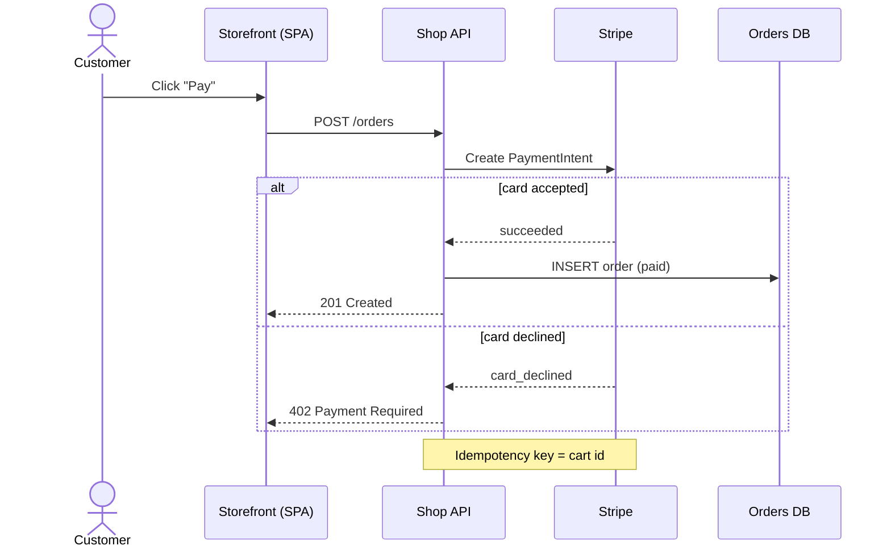

# UML behaviour diagrams: sequence, activity, state

Behaviour diagrams show what happens over time. In the 4+1 view model (Kruchten, 1995) they belong to the process view and the scenarios. In arc42, they belong to the runtime view (section 6). Each one should cover one scenario, one process or one object's lifecycle.

## Sequence diagram

**Use it when** the order of interactions between a few participants matters: a request path, an auth handshake, a retry or failure scenario, or an API integration. It is also the "sequence style" of a C4 dynamic diagram.

**Don't use it** for the static structure (use a container diagram), or for many branches (use an activity diagram).

### Notation

- **Participants** go across the top, in the order the reader meets them, usually left to right from the initiator. Actors are people or external callers.
- **Lifelines** run downward. Time flows down.
- **Messages:**
  - A solid line with a filled arrowhead is a synchronous call.
  - An open arrowhead is an asynchronous message.
  - A dashed line is a reply.
  - Label each message with the operation or payload (`POST /orders`, `OrderPlaced`).
- **Activation bars** show when a participant is busy.
- **Combined fragments:**
  - `alt` (if/else)
  - `opt` (optional)
  - `loop`
  - `par` (parallel)
  - `critical`
  - `break`
- **Notes** explain anything that isn't obvious.

### Excalidraw recipe

`mermaid_to_drawing` converts sequence diagrams into editable elements. Pass the source as the `mermaid` argument, along with `path`. Keep it to about 12 messages and 6 participants, and add a title afterwards.



Then add the title above the converted elements.

```json add_elements
{
  "path": "docs/diagrams/checkout-sequence",
  "elements": [{ "type": "text", "x": 0, "y": -80, "text": "Sequence: checkout payment", "fontSize": 28 }]
}
```

Check the x/y against `read_drawing` first: Mermaid output is placed to the right of any existing content. The converter drops the label of an `else` branch, so state that condition in the reply message itself (as `card_declined` does here) or in a `Note`.

### Common mistakes

- **Too many scenarios in one diagram.** Draw one sequence for the happy path and one for the failure path, or use one `alt`.
- **Participants that are classes** in a diagram meant for service-level readers. Keep participants at one level (C4 containers, say).
- **Replies drawn as calls,** or replies missing where the response carries meaning.
- **Message labels that are prose.** Use the operation name, endpoint or event name from the code.
- **Hiding async hops.** If a queue sits between two services, make the queue a participant.

## Activity diagram (and flowcharts)

**Use it when** you're showing the steps of a process or algorithm with decisions, loops and parallel branches: a deploy pipeline, an approval workflow, request validation, or onboarding. Swimlanes show who does each step.

### Notation

- A filled circle is the start. A circle with a ring is the end.
- Rounded rectangles are actions.
- Diamonds are decisions and merges. Label the outgoing edges with guards: `[valid]` and `[invalid]`, or `yes` and `no`.
- Bars are fork and join, for parallel work.
- Swimlanes (partitions) are columns or rows, one per actor or system.

Classic flowchart notation (ISO 5807) is close enough: an oval for start and end, a rectangle for a process, a diamond for a decision, and a parallelogram for I/O.

### Excalidraw recipe

`create_diagram` with `direction: "TB"`. Use ellipses for start and end, diamonds for decisions, and groups for swimlanes:

```json create_diagram
{
  "path": "docs/diagrams/deploy-pipeline",
  "direction": "TB",
  "title": "Activity: deploy to production",
  "nodes": [
    { "id": "start", "label": "Merge to main", "shape": "ellipse", "color": "gray" },
    { "id": "build", "label": "Build and test", "color": "blue" },
    { "id": "green", "label": "Tests pass?", "shape": "diamond", "color": "yellow" },
    { "id": "stage", "label": "Deploy to staging", "color": "blue" },
    { "id": "fail", "label": "Notify author", "color": "red" },
    { "id": "approve", "label": "Approved?", "shape": "diamond", "color": "yellow" },
    { "id": "prod", "label": "Deploy to production", "color": "blue" },
    { "id": "cancel", "label": "Release cancelled", "shape": "ellipse", "color": "gray" },
    { "id": "end", "label": "Released", "shape": "ellipse", "color": "gray" }
  ],
  "edges": [
    { "from": "start", "to": "build" },
    { "from": "build", "to": "green" },
    { "from": "green", "to": "stage", "label": "yes" },
    { "from": "green", "to": "fail", "label": "no", "style": "dashed" },
    { "from": "stage", "to": "approve" },
    { "from": "approve", "to": "prod", "label": "yes" },
    { "from": "approve", "to": "cancel", "label": "no", "style": "dashed" },
    { "from": "prod", "to": "end" }
  ]
}
```

Give each branch its own end node rather than routing it back to a shared "Done": an edge that skips a layer is drawn straight through the nodes in between.

For swimlanes, use groups, but only when each lane is a band of consecutive steps. A group's frame is the bounding box of its members, so a lane whose steps sit level with another lane's steps will overlap it. For lanes that interleave, use Mermaid `flowchart TD` with `subgraph` lanes, or one diagram per actor.

Mermaid `flowchart TD` is the alternative when the user already has Mermaid. It converts to editable elements.

### Common mistakes

- **Unlabelled decision branches.** Every edge out of a diamond needs a guard.
- **Decisions phrased as statements.** Phrase them as yes/no questions.
- **Flow running in several directions.** Keep the main path straight down. Make loops and failure paths dashed.
- **Mixing levels of detail,** like "Deploy" next to "Set env var FOO".
- **Lanes that don't match real actors or systems.**

## State machine diagram

**Use it when** one thing (an order, a connection, a document, a UI component) has a lifecycle with a fixed set of states, and events move it between them. It is the right picture for status enums in code.

### Notation

- Rounded rectangles are states.
- A filled circle is the initial state, and a ringed circle is a final state.
- Each transition arrow is labelled `event [guard] / action`.
- Composite states contain sub-states.
- A state can have `entry /`, `exit /` and `do /` activities.
- A self-transition is a loop back to the same state.

### Excalidraw recipe

Use `create_diagram`. States are rounded rectangles, the initial pseudo-state is a small ellipse, and final states are marked with a tag and a colour (green for success, gray or red for the other endings):

```json create_diagram
{
  "path": "docs/diagrams/order-states",
  "direction": "LR",
  "title": "State machine: Order.status",
  "nodes": [
    { "id": "initial", "label": "start", "shape": "ellipse", "color": "black" },
    { "id": "pending", "label": "Pending", "color": "blue" },
    { "id": "paid", "label": "Paid", "color": "blue" },
    { "id": "cancelled", "label": "Cancelled\n(final)", "color": "gray" },
    { "id": "shipped", "label": "Shipped", "color": "blue" },
    { "id": "refunded", "label": "Refunded\n(final)", "color": "red" },
    { "id": "delivered", "label": "Delivered\n(final)", "color": "green" }
  ],
  "edges": [
    { "from": "initial", "to": "pending", "label": "order_created" },
    { "from": "pending", "to": "paid", "label": "payment_succeeded" },
    { "from": "pending", "to": "cancelled", "label": "cancel [not paid]" },
    { "from": "paid", "to": "shipped", "label": "shipment_created / email customer" },
    { "from": "paid", "to": "refunded", "label": "refund_issued" },
    { "from": "shipped", "to": "delivered", "label": "carrier_delivered" }
  ]
}
```

Mermaid `stateDiagram-v2` is the standard text form. In this build, `mermaid_to_drawing` brings it in as one uneditable image: the result says "Converted Mermaid into 1 elements". Only use it when the user wants Mermaid's own rendering.

Take the state and event names from the code (the enum values and handler names), and link the diagram to the file that defines the enum.

### Common mistakes

- **Drawing a flowchart and calling it a state machine.** States are conditions that last, not steps.
- **Transitions without events.**
- **States missing from the code's enum,** or enum values missing from the diagram.
- **No initial state.**
- **Terminal states that aren't marked.**
